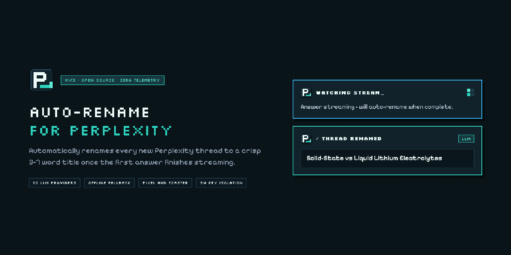
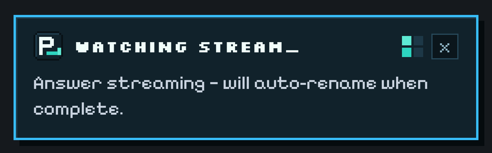
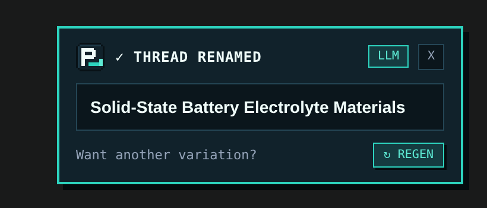
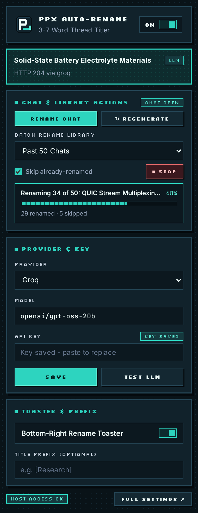
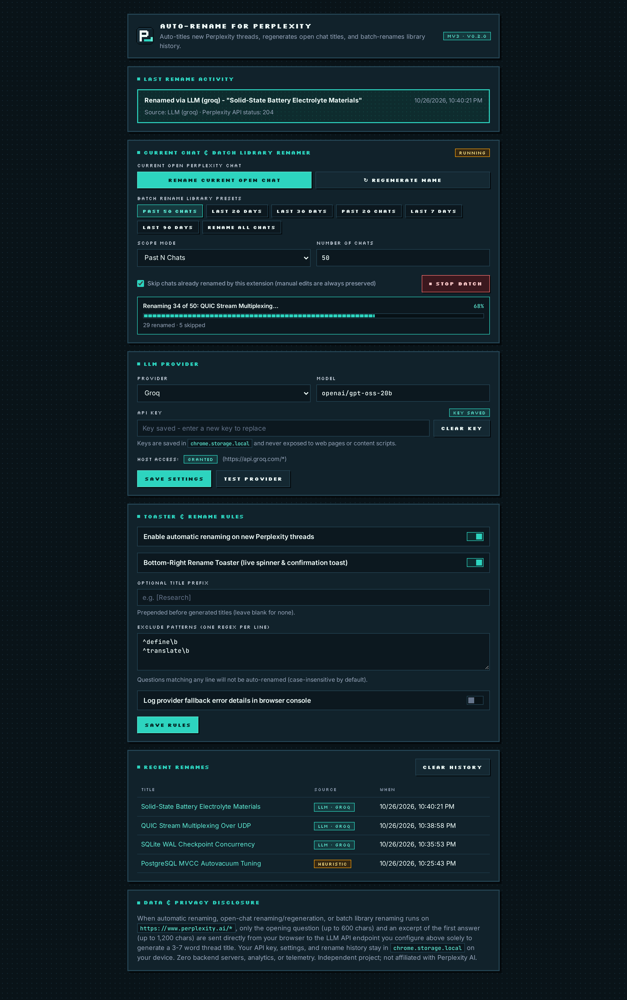
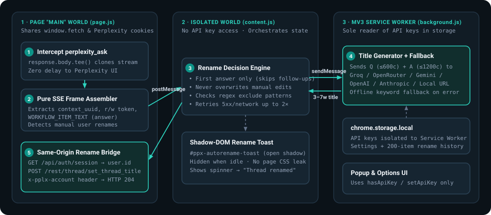

<div align="center">


# Auto-Rename for Perplexity

**Automatically renames every new Perplexity thread to a crisp, scannable 3–7 word title the moment its first answer finishes streaming.**

[](https://perplexity-autorename.vercel.app)
[](#how-it-actually-works-deep-dive)
[](#supported-llm-providers)
[](#development-building--testing)
[](https://perplexity-autorename.vercel.app/privacy-policy.html)
[](LICENSE)

[**Live Website & Interactive Simulator ↗**](https://perplexity-autorename.vercel.app) · [**Download v0.2.0 (.zip)**](https://perplexity-autorename.vercel.app/?download=1#install) · [**60-Second Install**](#quick-start-install-unpacked-in-60-seconds) · [**Architecture Deep-Dive**](#how-it-actually-works-deep-dive) · [**Privacy Policy**](https://perplexity-autorename.vercel.app/privacy-policy.html)

<br />

<a href="https://perplexity-autorename.vercel.app">
  
</a>

</div>

---

## Live Interactive Demo

Want to see how **Auto-Rename for Perplexity** behaves before installing? Try the live interactive stream & Pixel HUD simulator at **[perplexity-autorename.vercel.app](https://perplexity-autorename.vercel.app)** — test preset prompts, paste your own messy prompt or stack trace, add a `[Research]` prefix, and watch the `WATCHING STREAM_` → `✓ THREAD RENAMED` (`HTTP 204`) flow live in your browser.

---

## Why This Exists

By default, Perplexity names every thread in your sidebar using the raw opening words of your first prompt—leaving your Library full of truncated conversational noise:

| Without Auto-Rename (Default Sidebar) | With Auto-Rename (3–7 Words) |
| :--- | :--- |
| `Hey can you explain how solid-state batteries differ…` | **`Solid-State vs Liquid Lithium Electrolytes`** |
| `I'm getting a weird deadlock in Postgres when autova…` | **`PostgreSQL MVCC Autovacuum Tuning`** |
| `Can you compare zk-rollups vs optimistic rollups spec…` | **`Zero-Knowledge Rollup Proof Batching`** |
| `Please summarize recent papers on off-target effects…` | **`[Research] CRISPR Prime Editing Off-Target`** |

**Auto-Rename for Perplexity** watches only the **first answer** of a brand-new thread on `https://www.perplexity.ai`, summarizes the Q&A into a concise 3–7 word title via your chosen fast/free-tier LLM (or a built-in zero-latency offline keyword heuristic), and persists the new title directly to your Perplexity account (`HTTP 204`) so your sidebar stays clean across every device—without altering Perplexity's page layout or styles.

---

## Screenshots

### 1. Live Bottom-Right Pixel HUD Toaster on `perplexity.ai`
Rendered inside an isolated Shadow DOM (`#ppx-autorename-toast`) with bundled offline fonts (`Silkscreen` pixel headers + crisp `Inter` body) so zero styles leak onto Perplexity's page—and completely unmounted from the DOM whenever idle.

**While the first answer streams (`WATCHING STREAM_` + 2×2 pixel matrix spinner):**

<div align="center">
  
</div>

**Once the first answer finishes and `set_thread_title` returns `204` (`✓ THREAD RENAMED`):**

<div align="center">
  
</div>

### 2. One-Click Toolbar Quick Controls (`popup.html`)
Toggle auto-renaming on/off, check your last rename status, switch between 10 LLM providers, paste or replace API keys, test live LLM latency, toggle the bottom-right toaster, or set an optional title prefix straight from Chrome's toolbar:

<div align="center">
  
</div>

### 3. Full Settings, Exclude Regex Rules & Rename History (`options.html`)
Configure providers and host permissions, define line-by-line regular-expression exclude filters, inspect clickable links to your 200 most recently renamed threads, and review the local storage & privacy disclosure:

<div align="center">
  
</div>

---

## Real-World Use Cases

1. **Deep Research & Topic Clustering (`[Research]` Prefix):**
   Add an optional prefix such as `[Research]` or `[Paper]` during a research sprint so related threads group visually in your Perplexity sidebar while keeping crisp 3–7 word subject titles.
2. **Debugging & Pasted Stack Traces:**
   When you paste a 30-line traceback or compiler error as your first message, Perplexity normally titles the thread `Traceback (most recent call last): File "/app/main…`. Auto-Rename uses both your prompt and the completed answer to name it `FastAPI Async SQLAlchemy Session Leak`.
3. **Skipping Throwaway / Utility Prompts:**
   Add regular expressions in **Exclude Patterns** (e.g., `^define\b`, `^translate\b`, `^(hi|hello|test)\b`) so quick dictionary/translation lookups are ignored without spending a single token.
4. **100% Local / Air-Gapped Mode (Ollama, LM Studio, or Offline Heuristic):**
   - Point **Custom Base URL** at `http://localhost:11434/v1` (Ollama) or `http://127.0.0.1:1234/v1` (LM Studio) to generate LLM titles entirely on your own hardware.
   - Or use the extension with **no API key at all**—the built-in deterministic keyword extractor (`heuristicTitle()`) generates clean 3–7 word titles offline with zero network calls.
5. **Retroactive Batch Library Cleanup & On-Demand Regenerate (`v0.2.0`):**
   - **Open Chat Actions:** Click **Rename Chat** or **↻ Regenerate** in the toolbar popup (or `↻ REGEN` right on the bottom-right HUD toast) to rename any open `/search/<slug>` thread or generate a fresh non-repeating variation on demand.
   - **Batch Library Renamer:** Clean up existing history in one click — **Past 50 Chats**, **Past 20 Chats**, **Last 20 Days**, **Last 30 Days**, **Custom Count / Days**, or **Rename All Library Chats** — with live progress, polite pacing, skip-already-renamed toggle, and instant **■ Stop**.
6. **Never Fights Manual Edits or Follow-Ups:**
   If you manually rename a thread in Perplexity's UI, Auto-Rename intercepts that outgoing edit and permanently locks out auto-renaming for that `context_uuid`. Follow-up questions in existing threads are skipped automatically so your titles stay stable.

---

## Quick Start (Install Unpacked in 60 Seconds)

### Option A — Download the Prebuilt Release ZIP (No Node.js Needed)
1. Download **`auto-rename-for-perplexity-v0.2.0.zip`** from **[perplexity-autorename.vercel.app](https://perplexity-autorename.vercel.app/?download=1#install)** or the GitHub [Releases](../../releases) page, and unzip it.
2. Open `chrome://extensions` in Chrome / Brave / Arc / Edge and enable **Developer mode** (top right).
3. Click **Load unpacked** and select the unzipped folder.

### Option B — Build From Source
```bash
git clone https://github.com/sarang-cmd/perplexity-autorename.git
cd perplexity-autorename
npm install
npm run build
npm test
```
Then open `chrome://extensions` → enable **Developer mode** → click **Load unpacked** → select the **`extension/`** folder inside this repository.

---

## Supported LLM Providers

| Provider | Default Fast Model | API Key Required? | Endpoint / Protocol Handled Automatically |
| :--- | :--- | :---: | :--- |
| **Groq** *(Default)* | `openai/gpt-oss-20b` | Yes | OpenAI `/openai/v1/chat/completions` (`reasoning_effort: "low"`) |
| **OpenRouter** | `meta-llama/llama-3.3-70b-instruct:free` | Optional (free tier) | OpenAI `/api/v1/chat/completions` |
| **Google Gemini** | `gemini-2.5-flash-lite` | Yes | Native `v1beta/models/<id>:generateContent` (`thinkingBudget: 0`) |
| **OpenAI** | `gpt-5-nano` | Yes | OpenAI `/v1/chat/completions` (`max_completion_tokens: 256`) |
| **Anthropic** | `claude-haiku-4-5` | Yes | Native `/v1/messages` + browser CORS access header |
| **Mistral** | `mistral-small-latest` | Yes | OpenAI `/v1/chat/completions` |
| **Cerebras** | `llama3.1-8b` | Yes | OpenAI `/v1/chat/completions` |
| **OpenCode Zen** | `gpt-5-nano` | Yes | Multi-protocol router (`/responses`, `/messages`, `:generateContent`, `/chat/completions`) |
| **Sarvam** | `sarvam-105b` | Yes | `/v1/chat/completions` (`api-subscription-key` + Bearer) |
| **Custom URL** | `gpt-4o-mini` *(editable)* | Optional | Any OpenAI-compatible `/v1` or `/chat/completions` URL (Ollama, LM Studio, vLLM, LiteLLM) |

---

## How It Actually Works (Deep Dive)

This section documents the exact engineering mechanics behind the extension—both for security auditing and so **anyone can recreate this architecture from scratch** (or adapt it to other streaming AI web apps).

<div align="center">
  
</div>

### 1. Why Naive Approaches Fail on Modern Streaming AI Apps
If you try to build a thread auto-renamer by scraping DOM nodes with a `MutationObserver` or calling Perplexity's backend from a background script, you hit four immediate roadblocks:
1. **DOM mutations don't tell you when streaming truly finished** (citations, related follow-up chips, and markdown re-renders continue mutating the DOM after the answer ends—or pause mid-stream).
2. **Persisting a rename requires internal stream tokens:** Perplexity's rename endpoint requires both the thread's internal `context_uuid` and its `read_write_token`, which are emitted inside the Server-Sent Events (SSE) payload—not the URL bar.
3. **`ReadableStream` bodies are single-consumer:** If an injected script calls `response.text()` on `fetch()`, Perplexity's React app throws `TypeError: body stream already read` and breaks the UI.
4. **Cloudflare & Same-Origin Session Context:** Calling Perplexity endpoints from a background service worker lacks same-origin context and requires the account's internal `user.id` in a custom `x-pplx-account` header.

### 2. Non-Destructive Stream Cloning With `Response.body.tee()` (`src/page/inject.js`)
In `extension/manifest.json`, `page.js` runs in `"world": "MAIN"` at `"run_at": "document_start"`, wrapping `window.fetch` before Perplexity's frontend bundles initialize.

When Perplexity sends `POST /rest/sse/perplexity_ask`, `page.js` awaits the real `fetch` response and splits its `ReadableStream` into two independent branches via [`ReadableStream.prototype.tee()`](https://developer.mozilla.org/en-US/docs/Web/API/ReadableStream/tee):

```js
const response = await originalFetch.apply(this, args);

if (isAskSseRequest && response.ok && response.body?.tee) {
  const [pageBranch, observerBranch] = response.body.tee();

  // Branch 2 is parsed asynchronously in the background
  observeAskStream(observerBranch, requestMeta);

  // Branch 1 is returned immediately to Perplexity's UI with original headers/status
  return new Response(pageBranch, {
    status: response.status,
    statusText: response.statusText,
    headers: response.headers,
  });
}
```
Perplexity's UI streams tokens at native speed on `pageBranch`, while `observerBranch` feeds chunks through a streaming `TextDecoder` into our pure SSE frame assembler (`src/lib/sse.js`).

### 3. Reverse-Engineered Perplexity Wire Contract (`src/config/selectors.js` & `src/lib/sse.js`)
Every Perplexity endpoint path, header name, and JSON key lives exclusively inside **`src/config/selectors.js`** (enforced by automated tests in `tests/e2e.test.js`):

- **Detecting First Turn vs. Follow-Up (`POST /rest/sse/perplexity_ask`):**
  The JSON request body carries `{ query_str, params }`. A request is a **new thread's first question** if and only if:
  - `params.last_backend_uuid` is empty/`null` (follow-ups pass the previous entry's UUID here), AND
  - `params.is_related_query` is not `true` / `"True"` (clicks on suggested related queries).
- **Incremental SSE Frame Assembly (`src/lib/sse.js`):**
  - Splits both `\r\n\r\n` and `\n\n` SSE frame boundaries cleanly—even when a `\r\n\r\n` delimiter straddles two `Uint8Array` network chunks.
  - **Frame 1** provides `context_uuid`, `read_write_token`, and `backend_uuid` (used for clickable `/search/<backend_uuid>` links in Rename History).
  - **Answer Extraction without Duplication:** Perplexity emits structured `blocks[]` entries where `block.type === "WORKFLOW_ITEM_TEXT"` and `block.payload.text_payload.variant === "answer"`. Completed frames contain **both** a full `text` string and a `chunks: [...]` array—our extractor reads `text` when non-empty and falls back to `chunks.join("")` only when `text` is absent, preventing duplicated text.
  - **Completion Signal:** Fires when a frame carries `status === "COMPLETED"` / `final === true` / `final_sse_message === true` or `event: end_of_stream`.
- **Detecting Manual User Renames (Zero Overwrites):**
  Our internal rename bridge tags its `RequestInit` object with a private `Symbol("ppx-autorename-internal")` before calling `window.fetch`. Whenever `window.fetch` observes a `POST /rest/thread/set_thread_title` call *without* that `Symbol`, it knows **the user manually renamed the thread in Perplexity's UI**, posts `USER_RENAME` to `content.js`, and permanently locks out auto-renaming for that `context_uuid`.

### 4. The 3-World Chrome MV3 Security Boundary
Chrome Manifest V3 separates scripts into distinct privilege worlds. We use all three deliberately so **your LLM API key can never touch web-page memory**:

1. **`MAIN` World (`src/page/inject.js` → `extension/page.js`):**
   Shares `window.fetch` and same-origin cookies on `www.perplexity.ai`, has **zero** `chrome.*` APIs, and **zero** access to storage or API keys. Communicates with `content.js` via namespaced `window.postMessage` events.
2. **`ISOLATED` Content Script (`src/content/content.js` → `extension/content.js`):**
   Runs the pure decision gate (`shouldRename()` in `src/lib/decide.js`), mounts the Shadow-DOM pixel HUD toaster (`src/content/toast.js`), and coordinates up to 2 retries (`600ms` / `1800ms` backoff) on HTTP 5xx or transient network errors. Never sees the API key.
3. **Background Service Worker (`src/background/service-worker.js` → `extension/background.js`):**
   **The sole module in the entire repository permitted to call `getApiKey()`** (verified by `tests/e2e.test.js`). Popup and Options scripts only ever call `hasApiKey()`, `setApiKey()`, and `clearApiKey()`.
   - Returns `false` synchronously from `chrome.runtime.onMessage` for any message not tagged with `ns: "ppx-autorename"` so other Chrome extensions' message channels are never held open.
4. **Same-Origin Persistence (`src/lib/perplexity-api.js`):**
   Once `background.js` returns the sanitized 3–7 word title, `content.js` asks `page.js` to persist it:
   - `page.js` calls `GET /api/auth/session` once per page lifetime and caches **only** `user.id` in memory.
   - Sends `POST /rest/thread/set_thread_title?version=2.18&source=default` with headers `x-pplx-account: <user.id>`, `x-app-apiversion: "2.18"`, `x-perplexity-request-reason: "thread-item"`, and JSON body `{ context_uuid, title, read_write_token }`, receiving **`HTTP 204 No Content`**.

### 5. Solving Reasoning-Model Quirks & Offline Fallback (`src/lib/providers/` & `src/lib/title.js`)
Modern fast/reasoning models have subtle API differences that break generic OpenAI wrappers if not handled explicitly:
- **Reasoning Token Starvation:** Models like Groq's `openai/gpt-oss-20b` spend completion tokens on internal reasoning before emitting `message.content`. If `max_tokens` is set too low (e.g., `32`), the model exhausts its budget thinking and returns `content: ""`. We pass `max_tokens: 256` + `reasoning_effort: "low"` on `gpt-oss-*`, `thinkingConfig: { thinkingBudget: 0 }` on Gemini 2.5 Flash, and `max_completion_tokens: 256` on OpenAI.
- **Sanitization (`sanitizeTitle()`):** Strips `<think>...</think>` blocks (including unclosed `<think>`), leading labels (`Title:`, markdown `#` / `*`, wrapping quotes), newlines, and trailing punctuation, then caps output cleanly to 3–7 words without dangling conjunctions.
- **Guaranteed Offline Fallback (`heuristicTitle()`):** If no API key is configured, host permission hasn't been granted yet, or an API times out (`10s` `AbortController`), `generateTitleWithFallback()` falls back to a deterministic stopword-aware keyword extractor that preserves technical casing (`FastAPI`, `PostgreSQL`, `LiPF6`, `MVCC`) and redacts any echoed secret from error messages.

### 6. Blueprint to Recreate This Pattern for Any Streaming Web App
1. **Capture a HAR trace** in Chrome DevTools (*Network → Fetch/XHR*) of (a) asking the first question in a new chat, (b) asking a follow-up question, and (c) manually renaming the chat in the sidebar.
2. **Isolate the wire contract** in one config module (`src/config/selectors.js`): stream URL, turn-1 vs. follow-up field, SSE completion signal, and rename endpoint + headers.
3. **Clone the stream in `MAIN` world** at `document_start` using `response.body.tee()` so the host frontend streams untouched.
4. **Keep parsing & decision modules pure** (`sse.js`, `decide.js`, `title.js`) so 100% of edge cases run under `node --test` in milliseconds without needing a browser.
5. **Isolate API keys inside the MV3 Service Worker** (`chrome.storage.local` + runtime `optional_host_permissions`) and isolate any in-page notification inside a ShadowRoot.

---

## Repository Structure

```text
.
├── build.mjs                      # esbuild bundler (background ESM + content/page/popup/options IIFE)
├── serve-docs.mjs                 # Zero-dependency local preview server for the landing page
├── vercel.json                    # Zero-config Vercel static deployment descriptor -> docs/
├── package.json                   # Zero runtime npm dependencies; esbuild devDependency only
├── extension/                     # Ready-to-load Chrome MV3 unpacked extension directory
│   ├── manifest.json              # MV3 manifest ("storage" + perplexity.ai + optional LLM hosts)
│   ├── pixel-ui.css               # Retro pixel UI stylesheet (Popup & Settings only)
│   ├── fonts/                     # Bundled offline OFL fonts (Silkscreen, Inter, JetBrains Mono)
│   ├── popup.html                 # Toolbar quick-controls popup
│   ├── options.html               # Full Settings, Regex Exclusions, History & Privacy Disclosure
│   ├── icons/                     # Bit-exact pixel `P_` icons (16, 32, 48, 128 px)
│   └── *.js                       # Compiled bundles generated by `npm run build`
├── src/
│   ├── config/selectors.js        # Single source of truth for Perplexity endpoints & field names
│   ├── page/inject.js             # MAIN-world fetch wrapper, body.tee() observer & rename bridge
│   ├── content/
│   │   ├── content.js             # ISOLATED-world orchestrator & retry state machine
│   │   └── toast.js               # Shadow-DOM bottom-right pixel HUD Rename Toaster
│   ├── background/
│   │   └── service-worker.js      # MV3 Service Worker (sole reader of stored API keys)
│   ├── popup/popup.js             # Toolbar popup controller
│   ├── options/options.js         # Settings page controller
│   ├── ui/pixel-logo.js           # Bit-exact 16x16 crispEdges SVG `P_` logo helper
│   └── lib/
│       ├── sse.js                 # Pure incremental SSE frame splitter & Perplexity parser
│       ├── decide.js              # Pure rename eligibility & regex exclusion helpers
│       ├── title.js               # Title sanitizer & offline keyword heuristic fallback
│       ├── perplexity-api.js      # Session user.id cache & set_thread_title request builder
│       ├── storage.js             # chrome.storage.local wrappers & key-isolation helpers
│       └── providers/             # 10 LLM adapters (OpenAI-compat, Gemini, Anthropic, Zen, etc.)
├── tests/                         # 53 Node.js unit, provider, UI, security & E2E pipeline tests
├── store-assets/                  # Chrome Web Store 128x128 icon, 440x280 promo & 1280x800 shots
└── docs/                          # Live Website -> https://perplexity-autorename.vercel.app
    ├── index.html                 # Interactive Pixel HUD Landing Page (Vercel & GitHub Pages ready)
    ├── styles.css                 # Landing page & privacy policy pixel stylesheet
    ├── site.js                    # Live stream/HUD simulator & 10-provider inspector
    ├── release-bundle.js          # Self-contained v0.2.0 extension ZIP payload (zero-404 download)
    ├── assets/                    # Pixel SVG logo, fonts, architecture diagram, banner & screenshots
    ├── FONT-LICENSES.md           # SIL Open Font License 1.1 notices (Silkscreen, Inter, JetBrains Mono)
    ├── CHROME_WEB_STORE_GUIDE.md  # Full Chrome Web Store publishing guide (for future launch)
    ├── PRIVACY_POLICY.md          # Markdown privacy policy
    └── privacy-policy.html        # Live HTML privacy policy (/privacy-policy.html)
```

---

## Development, Building & Testing

```bash
# Install dev dependencies (esbuild)
npm install

# Bundle src/ -> extension/{background,content,page,popup,options}.js
npm run build

# Run all 53 automated tests
npm test

# Preview the landing page locally on http://localhost:4173
npm run site

# Package a clean release ZIP (manifest.json at archive root)
npm run zip
```

---

## Guides, Troubleshooting & Browser Tutorials

- [**All Guides & Fixes Hub**](https://perplexity-autorename.vercel.app/guides/)
- [**How to Fix Messy or Cut-Off Perplexity Thread Titles Automatically**](https://perplexity-autorename.vercel.app/fix-perplexity-thread-titles/)
- [**How to Organize Your Perplexity Library & Search History (Prefixes & Regex)**](https://perplexity-autorename.vercel.app/organize-perplexity-library/)
- [**60-Second Unpacked Install Guide for Chrome, Brave, Arc & Edge**](https://perplexity-autorename.vercel.app/install-chrome-brave-arc-edge/)
- [**Free & Local AI Setup: Groq, Gemini, OpenRouter, Ollama & Offline Mode**](https://perplexity-autorename.vercel.app/free-groq-ollama-setup/)
- [**Why Perplexity Doesn't Auto-Name Threads Like ChatGPT or Claude**](https://perplexity-autorename.vercel.app/perplexity-vs-chatgpt-claude-thread-titles/)
- [**Troubleshooting Guide: Host Access, Ollama 403 CORS & Reasoning Models**](https://perplexity-autorename.vercel.app/troubleshooting/)
- [**Open-Source Perplexity.ai Browser Setup & MV3 Privacy Guide**](https://perplexity-autorename.vercel.app/perplexity-chrome-extensions/)

---

## Links, Privacy, Font Licenses & Disclaimer

- **Website & Interactive Demo:** [https://perplexity-autorename.vercel.app](https://perplexity-autorename.vercel.app)
- **Privacy Policy:** [https://perplexity-autorename.vercel.app/privacy-policy.html](https://perplexity-autorename.vercel.app/privacy-policy.html) (also in [`docs/PRIVACY_POLICY.md`](docs/PRIVACY_POLICY.md)) — Zero developer servers or telemetry; API keys stay locally in `chrome.storage.local` and are read exclusively inside `src/background/service-worker.js`.
- **Bundled Fonts:** `Silkscreen`, `Inter`, and `JetBrains Mono` are bundled locally under the SIL Open Font License 1.1 ([`docs/FONT-LICENSES.md`](docs/FONT-LICENSES.md)).
- **Disclaimer:** **Auto-Rename for Perplexity** is an independent open-source project and is **not affiliated with, endorsed by, or sponsored by Perplexity AI, Inc.**
- **License:** [MIT License](LICENSE).
